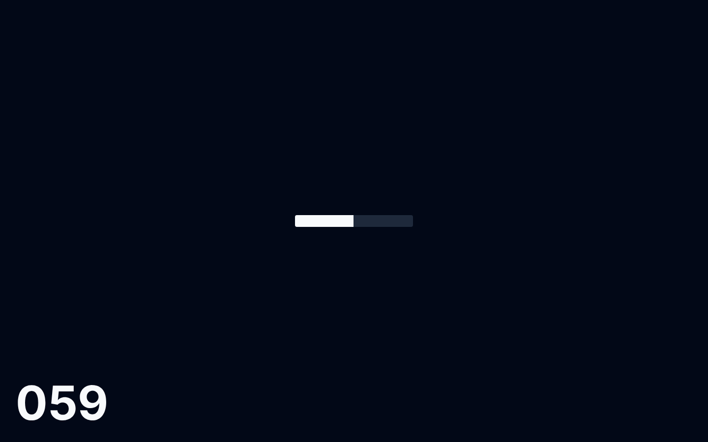
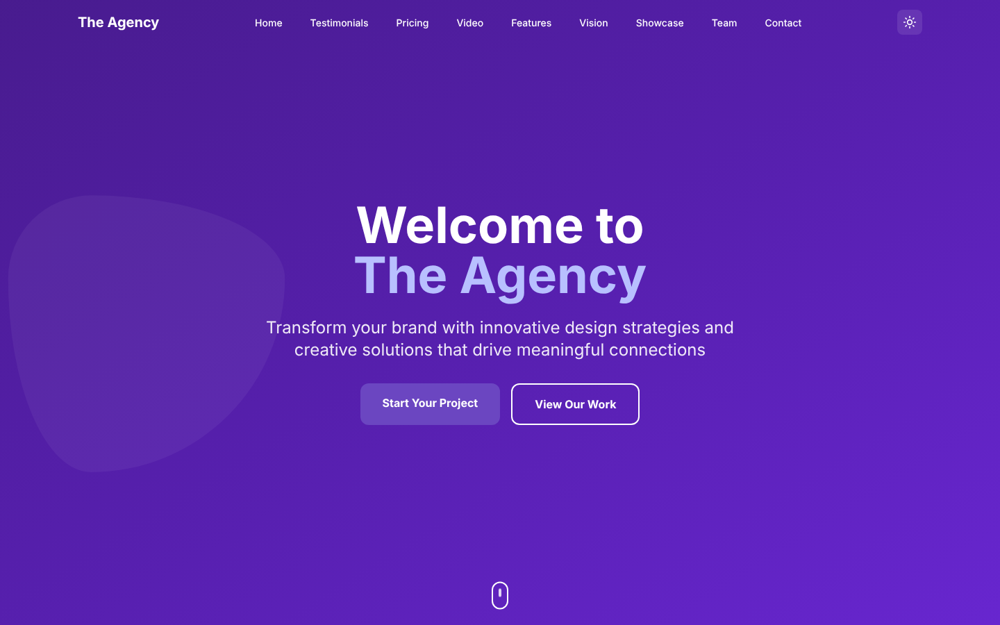
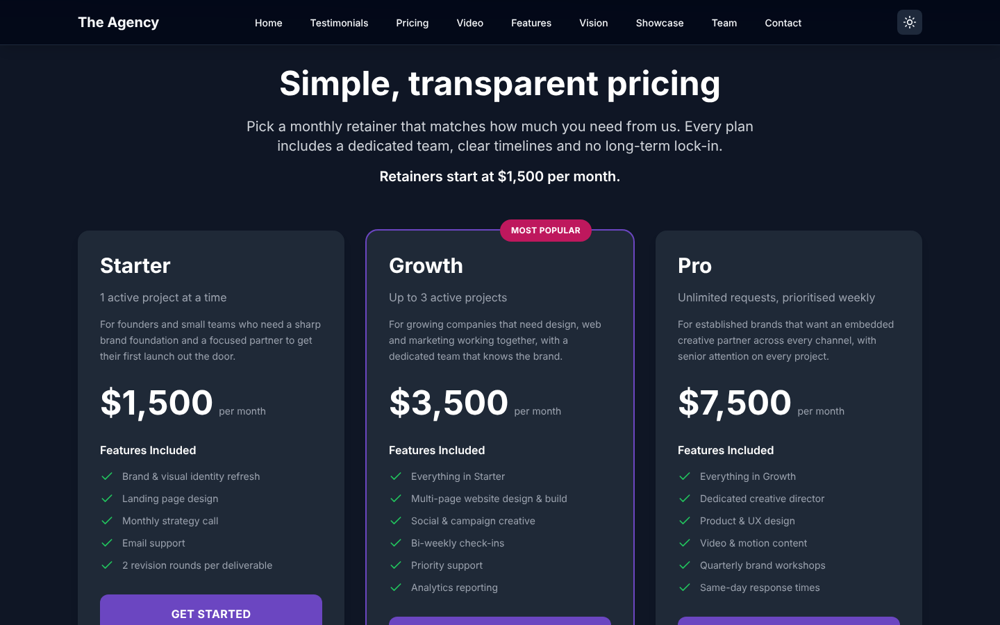
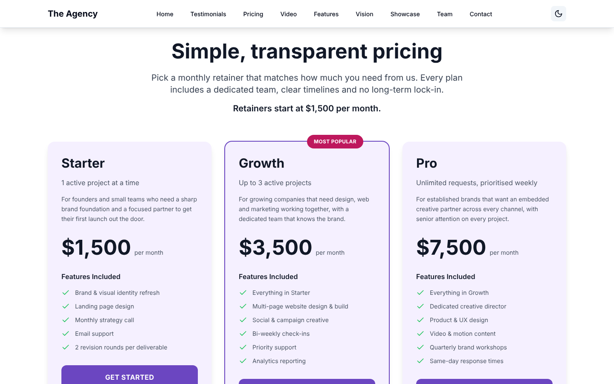
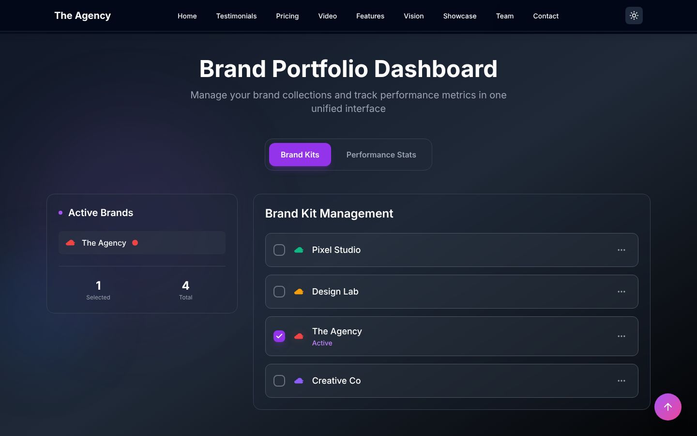
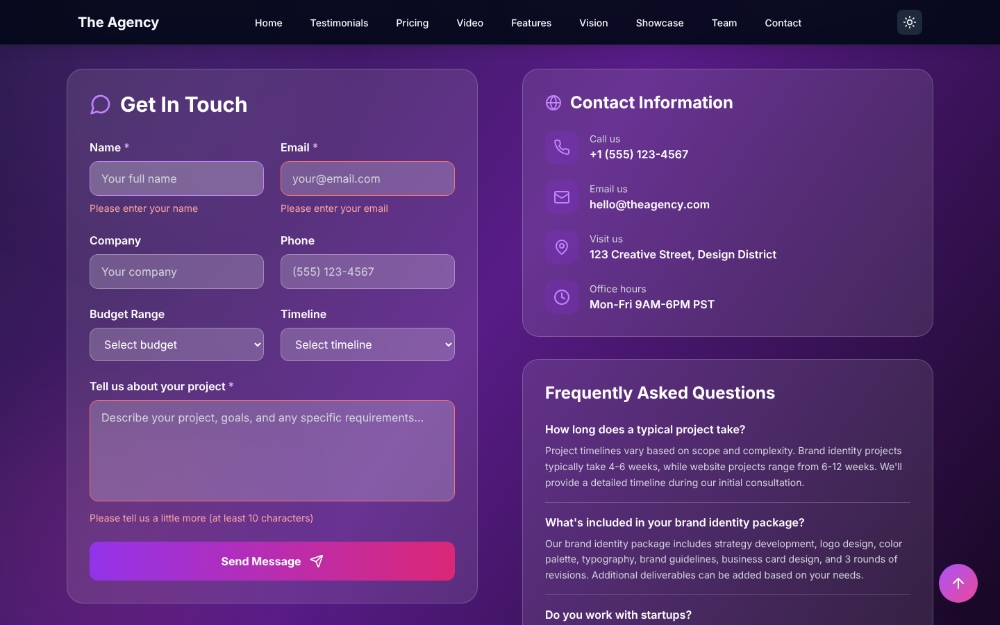
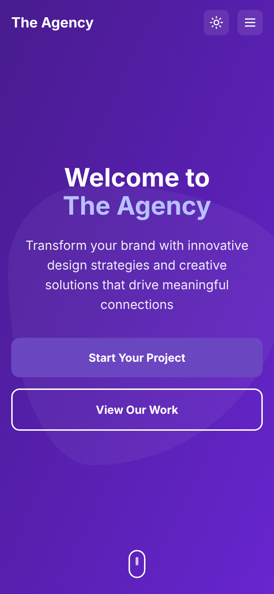
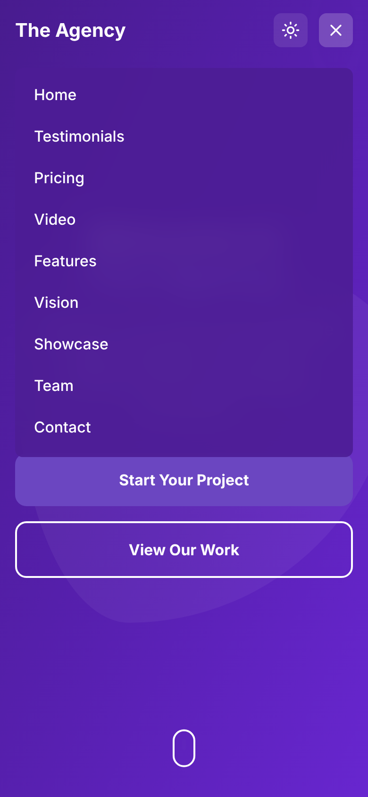
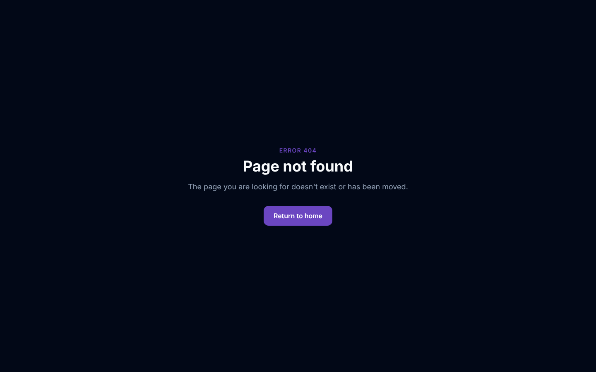
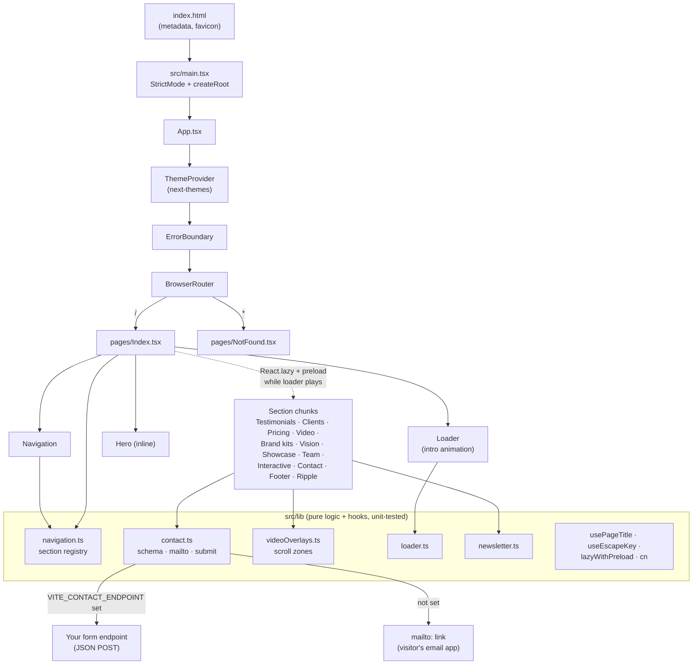

# The Agency — Animated Agency Landing Page

> A motion-rich, responsive marketing site for a creative studio, built with
> React, TypeScript, Vite and Tailwind CSS.


**Live site:** https://builder-vortex-haven.vercel.app/

## Overview

"The Agency" is a fictional creative studio. This project is its one-page
marketing site, built as a showcase for front-end craft rather than a plain
brochure:

- an intro loader that "breaks apart" into the page
- a WebGL ripple layer that follows the cursor
- scroll-driven video, parallax and testimonial sections
- interactive galleries and modals
- a working, validated contact form
- dark and light themes

It's aimed at:

- **developers and designers** looking for a reference for scroll-linked
  animation, WebGL effects and accessible motion in React;
- **agencies and freelancers** who want a starting point for a portfolio or
  studio site. Swap the placeholder copy and images for your own.

The site is entirely static. There is no backend, database or login.
Enquiries go to any form endpoint you configure, or open the visitor's email
app.

## Screenshots

These were captured from the production build (`npm run build && npm run
preview`) with headless Chromium. The photos in some sections come from the
Pexels CDN and are left out here.

| Intro loader                                 | Hero (dark theme)                               |
| -------------------------------------------- | ----------------------------------------------- |
|  |  |

| Pricing — dark theme                                       | Pricing — light theme                                        |
| ---------------------------------------------------------- | ------------------------------------------------------------ |
|  |  |

| Brand portfolio dashboard                                | Contact form with validation errors                                 |
| -------------------------------------------------------- | ------------------------------------------------------------------- |
|  |  |

| Mobile hero                                      | Mobile menu                                            | 404 page                                          |
| ------------------------------------------------ | ------------------------------------------------------ | ------------------------------------------------- |
|  |  |  |

## Features

### Page sections

| Section               | What it does                                                                                                                |
| --------------------- | --------------------------------------------------------------------------------------------------------------------------- |
| **Intro loader**      | Counts 000 → 100 on a linear progress bar, then breaks the bar into an L shape and wipes away to reveal the page            |
| **Navigation**        | Sticky, blurred navbar; mobile menu with `aria-expanded` that closes with Escape; dark/light toggle; skip-to-content link   |
| **Hero**              | Gradient hero with drifting blob shapes and two calls to action                                                             |
| **Ripple background** | WebGL fragment shader that draws iridescent ripples under the cursor, with a CSS fallback when WebGL is unavailable         |
| **Testimonials**      | Scroll-phased layouts (intro → split → full-screen) with ratings and project tags                                           |
| **Client carousel**   | Auto-advancing image grid with previous/next buttons and labelled pagination dots                                           |
| **Pricing**           | Three retainer tiers with a highlighted "Most Popular" plan; CTAs jump to the contact form                                  |
| **Scroll video**      | Video that grows as you scroll, with overlays (testimonial, stats, action panel) tied to scroll position and a modal player |
| **Brand dashboard**   | Tabbed "Brand Kits / Performance Stats" mock dashboard with selectable kits and animated counters                           |
| **Parallax vision**   | Layered parallax panels and a collaboration section                                                                         |
| **Showcase**          | Full-screen project carousel, project-detail modal and an "all projects" gallery modal                                      |
| **Team & about**      | Company stats, story, values and a team grid with profile modals                                                            |
| **Interactive field** | Thirty shapes that react to the cursor with spring physics and spawn ripples                                                |
| **Contact**           | Service picker, validated enquiry form, contact details, FAQ and a scheduling CTA                                           |
| **Footer**            | Validated newsletter sign-up, service/company/resource/legal columns, socials and a back-to-top link                        |

### Across the whole site

- **Responsive:** checked at 375 px (phone), 768 px (tablet) and 1280–1440 px
  (desktop), with no horizontal scrolling. Below `lg` the navbar switches to a
  hamburger menu.
- **Accessible:**
  - semantic landmarks, one `<h1>` per page and a skip link
  - visible `:focus-visible` rings and labelled form fields with inline errors
    tied to `aria-describedby`
  - `aria-label`s on icon-only buttons and `aria-pressed`/`aria-current` on
    toggles
  - modals use `role="dialog"` and close with Escape
  - a `prefers-reduced-motion` override
  - automated axe-core WCAG 2 A/AA checks pass in both themes (see
    [Testing](#testing))
- **Dark and light themes:** switched with `next-themes` (class strategy,
  defaults to dark and respects the system setting).
- **Loading, error and success states:**
  - the intro loader, plus a spinner fallback while a section's code loads
  - an error boundary with a reload screen
  - sending, error, success and "opened your mail app" states on both the
    contact form and the newsletter form
  - a themed 404 page
- **Performance:**
  - every section below the hero is lazy-loaded into its own chunk and
    prefetched while the intro plays (initial app chunk ≈ 44 kB, 15 kB gzipped)
  - React and Framer Motion are split into separate cacheable vendor chunks
  - the WebGL canvas is only resized when the viewport changes
- **Metadata:** page titles per route, meta description, Open Graph and
  Twitter card tags, theme colour and an SVG favicon.

## Tech stack

| Layer       | Choice                                                           |
| ----------- | ---------------------------------------------------------------- |
| UI library  | React 18 (StrictMode)                                            |
| Language    | TypeScript 5 (`strict`, `noUnused*`)                             |
| Build / dev | Vite 6 + `@vitejs/plugin-react-swc`                              |
| Routing     | React Router 7 (`react-router-dom`, SPA mode)                    |
| Styling     | Tailwind CSS 3, CSS-variable theme tokens, `tailwindcss-animate` |
| Animation   | Framer Motion 12 (scroll-linked values, springs, presence)       |
| Graphics    | Raw WebGL 1 fragment shader (no 3D library)                      |
| Theming     | `next-themes`                                                    |
| Validation  | Zod 4                                                            |
| Icons       | `lucide-react`                                                   |
| Testing     | Vitest 5, Testing Library, jsdom                                 |
| Quality     | ESLint 9 (typescript-eslint, react-hooks, jsx-a11y), Prettier 3  |
| Hosting     | Any static host; `vercel.json` included                          |

## Architecture



How the pieces fit together:

- **Single list of sections.** `src/lib/navigation.ts` lists every section id
  and label. `Index` renders a `<section id>` for each one and `Navigation`
  builds its links from the same list, so a menu link can't point at a
  section that doesn't exist. A unit test and an integration test both check
  this.
- **Logic lives outside components.** Validation, mailto encoding, env
  parsing, loader timing and scroll-overlay zones are plain functions in
  `src/lib/`. They are unit-tested without rendering, which keeps components
  focused on presentation.
- **Overlays follow scroll position, not timers.** Popups in the video section
  are shown or hidden from the section's scroll progress, so a fast scroll
  can't leave one stuck on screen. A dismissed popup stays closed until you
  scroll out of its zone.
- **Code splitting.** `lazyWithPreload` wraps `React.lazy` with a `preload()`
  function. `Index` calls it for every section as soon as it mounts, so the
  chunks are usually loaded before the intro animation finishes.
- **Theming.**
  - Colours are HSL CSS variables in `src/index.css`, under `:root` (light)
    and `.dark`, and are exposed to Tailwind as `background`, `foreground`,
    `muted`, `card`, `border` and so on.
  - Brand colours (`deep-purple-*`, `brand-purple`, `light-purple`,
    `vibrant-pink`) are defined in `tailwind.config.ts`.

## Getting started

### Prerequisites

- **Node.js 20.19 or newer** (verified on Node 22)
- **npm 10+** (ships with Node 20/22)
- A modern browser. WebGL is optional because the ripple layer falls back to
  CSS.

### Installation

```bash
# 1. Clone
git clone https://github.com/jeevithg090/Builder-vortex-haven.git
cd Builder-vortex-haven

# 2. Install exact dependency versions from the lockfile
npm ci

# 3. (Optional) configure the contact form
cp .env.example .env.local
#    then edit .env.local, see "Configuration" below

# 4. Start the dev server
npm run dev
```

Open http://localhost:8080. The dev server listens on all interfaces, so you
can also open it from a phone on the same network using the "Network" URL it
prints.

### Run a production build locally

```bash
npm run build     # type-safe production bundle in dist/
npm run preview   # serves dist/ on http://localhost:8080
```

## Configuration

All configuration is optional and done with Vite environment variables. They
are **baked into the bundle at build time** and are visible to anyone who
loads the site, so never put secrets in them. Copy `.env.example` to
`.env.local` for local development, or set them in your host's dashboard
before building.

| Variable                   | Required | Default               | Description                                                                                                                                                          |
| -------------------------- | -------- | --------------------- | -------------------------------------------------------------------------------------------------------------------------------------------------------------------- |
| `VITE_CONTACT_ENDPOINT`    | No       | _(empty)_             | HTTPS URL that receives contact-form submissions as a JSON `POST`. If empty, the form opens a pre-filled email instead.                                              |
| `VITE_CONTACT_EMAIL`       | No       | `hello@theagency.com` | Address shown in the contact section and used as the recipient of the mailto fallback.                                                                               |
| `VITE_NEWSLETTER_ENDPOINT` | No       | _(empty)_             | HTTPS URL that receives footer newsletter sign-ups as a JSON `POST` of `{ "email": "..." }`. If empty, subscribing opens a pre-filled email to `VITE_CONTACT_EMAIL`. |

## Usage

### A tour of the site

1. **Load the page.** The intro loader counts to 100 and breaks apart. While
   it plays, the code for the remaining sections downloads in the background.
2. **Navigate.** Use the navbar (or the hamburger menu below 1024 px) to jump
   to any section. On a keyboard, the first Tab shows a **Skip to content**
   link.
3. **Switch themes** with the sun/moon button. Your choice is saved in
   `localStorage` (managed by `next-themes`).
4. **Scroll through the video section.** The video grows, and overlays appear
   at set points: a testimonial at 40–60 % of the section, stats at 60–80 %
   and an action panel at 80–100 %. Click the play button to open the full
   player, and press **Esc** to close it.
5. **Open a project or team member.** Showcase cards and team cards open
   modals, which close with **Esc**, the close button or a click on the
   backdrop.
6. **Send an enquiry.** Optionally pick a service card, then fill in the form.
   Errors appear inline and focus jumps to the first invalid field.

### Contact form behaviour

Validation rules (`src/lib/contact.ts`):

| Field             | Rule                                                      |
| ----------------- | --------------------------------------------------------- |
| Name              | Required, 2–100 characters                                |
| Email             | Required, valid email address, ≤ 254 characters           |
| Company           | Optional, ≤ 100 characters                                |
| Phone             | Optional, digits, spaces and `+ ( ) . -` only, ≤ 30 chars |
| Budget / Timeline | Optional, must be one of the offered options              |
| Message           | Required, 10–5000 characters                              |

With `VITE_CONTACT_ENDPOINT` set, a valid submission sends:

```http
POST <VITE_CONTACT_ENDPOINT>
Content-Type: application/json
Accept: application/json

{
  "name": "Ada Lovelace",
  "email": "ada@example.com",
  "company": "Analytical Engines",
  "phone": "+1 555 123 4567",
  "budget": "10k-25k",
  "timeline": "1-2months",
  "service": "Brand Identity",
  "message": "We need a brand refresh for our launch."
}
```

- **2xx response:** the success state is shown.
- **Network failure or non-2xx response:** an inline, retryable error message
  is shown, for example _"Your message couldn't be sent (error 500)…"_.
- **No endpoint set:** the browser opens
  `mailto:<VITE_CONTACT_EMAIL>?subject=Project enquiry from <name>&body=…`,
  and the form shows a link to reopen it in case it didn't open.

The footer newsletter form works the same way with `VITE_NEWSLETTER_ENDPOINT`
(body: `{ "email": "ada@example.com" }`), falling back to a pre-filled email.

This site has no API of its own; the endpoint above is whatever service you
choose (for example Formspree, Getform, Basin or your own serverless
function).

## Scripts

| Command                | What it does                                                                          |
| ---------------------- | ------------------------------------------------------------------------------------- |
| `npm run dev`          | Start the Vite dev server with hot reload on port 8080                                |
| `npm run build`        | Build the production bundle into `dist/`                                              |
| `npm run preview`      | Serve the production build on port 8080                                               |
| `npm run typecheck`    | Type-check the app and config files (`tsc -b --noEmit`)                               |
| `npm run lint`         | Run ESLint over the project                                                           |
| `npm run lint:fix`     | Run ESLint and apply automatic fixes                                                  |
| `npm run format`       | Format every file with Prettier                                                       |
| `npm run format:check` | Check formatting without writing                                                      |
| `npm test`             | Run the test suite once                                                               |
| `npm run test:watch`   | Run tests in watch mode                                                               |
| `npm run check`        | Typecheck, lint, format check, tests and build, in that order. Run it before you push |

## Testing

```bash
npm test             # single run
npm run test:watch   # re-run on change
```

Tests use **Vitest** with **jsdom** and **Testing Library**. They sit next to
the code they cover (`*.spec.ts` / `*.spec.tsx`), and `src/test/setup.ts`
adds jest-dom matchers plus `matchMedia` and `IntersectionObserver` stubs.

| Area                                                           | What's covered                                                                                                       |
| -------------------------------------------------------------- | -------------------------------------------------------------------------------------------------------------------- |
| `lib/contact`                                                  | Schema rules, trimming, first-error-per-field, mailto encoding, env parsing, POST payload, HTTP and network failures |
| `lib/navigation`                                               | Unique, URL-safe section ids; nav links only point at real sections                                                  |
| `lib/videoOverlays`                                            | Zone boundaries, nothing visible before or after the section, dismissal and reset                                    |
| `lib/newsletter`                                               | Email validation, endpoint vs mailto fallback, HTTP and network failures                                             |
| `lib/loader`                                                   | Linear progress, clamping, invalid input                                                                             |
| `lib/usePageTitle`, `useEscapeKey`, `lazyWithPreload`, `utils` | Title set and restore, Escape handling and cleanup, single preload, class merging                                    |
| `components/Navigation`                                        | Every nav link rendered, mobile menu toggle and Escape, theme toggle                                                 |
| `components/ContactSection`                                    | Inline errors, focus on the first invalid field, errors clearing on edit, service toggles                            |
| `components/EnhancedFooter`                                    | Labelled newsletter field, validation without page reload, error reset, section links                                |
| `components/ErrorBoundary`                                     | Renders children; shows the fallback when a child throws                                                             |
| `pages/Index`                                                  | Loader → page hand-off, single `<h1>`, a section for every nav link, skip link                                       |
| `pages/NotFound`                                               | 404 copy, home link, document title                                                                                  |

The accessibility and responsiveness checks behind this README were run by
hand: axe-core (WCAG 2 A/AA) plus Playwright at 375, 768 and 1280 px in both
themes. They aren't part of `npm test`.

### Linting and formatting

- **ESLint** (`eslint.config.js`): recommended JS and TypeScript rules,
  `react-hooks`, `react-refresh` and `jsx-a11y`. Prettier owns formatting, so
  `eslint-config-prettier` turns off stylistic lint rules.
- **Prettier** (`.prettierrc`): 2-space indent and trailing commas.
  `.editorconfig` keeps editors consistent.

## Deployment

`npm run build` produces a fully static site in `dist/`.

### Vercel (current setup)

1. Import the repository in Vercel. It detects Vite on its own: build command
   `npm run build`, output folder `dist`.
2. Optionally add `VITE_CONTACT_ENDPOINT` / `VITE_CONTACT_EMAIL` under
   **Settings → Environment Variables**, then redeploy so they're baked in.
3. `vercel.json` rewrites every path to `index.html`, so client-side routes
   such as the 404 page survive a page reload.

### Netlify, Cloudflare Pages or any static host

- Build command `npm run build`, publish folder `dist`, Node 20.19+.
- Add an SPA fallback so unknown paths serve `index.html`. On Netlify that's
  a `public/_redirects` file containing `/*  /index.html  200`.

## Project structure

```
.
├── index.html                  # HTML shell: title, meta description, OG tags, favicon
├── public/
│   ├── favicon.svg             # Brand favicon (SVG)
│   ├── favicon.ico             # Legacy favicon
│   └── robots.txt
├── docs/screenshots/           # README screenshots captured from the running app
├── src/
│   ├── main.tsx                # Entry: StrictMode + createRoot
│   ├── App.tsx                 # ThemeProvider → ErrorBoundary → Router (/, *)
│   ├── index.css               # Tailwind layers, theme tokens, focus ring, reduced motion
│   ├── vite-env.d.ts           # Typed import.meta.env (VITE_CONTACT_*)
│   ├── pages/
│   │   ├── Index.tsx           # Loader → nav, hero and lazy-loaded sections
│   │   └── NotFound.tsx        # 404 page
│   ├── components/
│   │   ├── Loader.tsx          # Multi-phase intro animation
│   │   ├── Navigation.tsx      # Sticky navbar, mobile menu, theme toggle
│   │   ├── ErrorBoundary.tsx   # Render-error fallback
│   │   ├── RippleEffect.tsx    # WebGL cursor ripples + CSS fallback
│   │   ├── TestimonialsSection.tsx
│   │   ├── ClientCarousel.tsx
│   │   ├── PricingSection.tsx
│   │   ├── ScrollVideoSection.tsx
│   │   ├── BrandKitsWithStats.tsx
│   │   ├── ParallaxVision.tsx
│   │   ├── ShowcaseWork.tsx
│   │   ├── TeamAboutSection.tsx
│   │   ├── StrikingBackground.tsx
│   │   ├── ContactSection.tsx
│   │   └── EnhancedFooter.tsx
│   ├── lib/                    # Pure logic and hooks, each with a .spec file
│   │   ├── contact.ts          # Zod schema, mailto builder, env config, submit
│   │   ├── newsletter.ts       # Newsletter email validation and subscribe
│   │   ├── navigation.ts       # Section registry and nav items
│   │   ├── videoOverlays.ts    # Scroll zones for the video overlays
│   │   ├── loader.ts           # Loader timing maths
│   │   ├── lazyWithPreload.ts  # React.lazy + preload()
│   │   ├── useEscapeKey.ts     # Escape-to-close hook for modals and menus
│   │   ├── usePageTitle.ts     # document.title helper + SITE_NAME
│   │   └── utils.ts            # cn() — clsx + tailwind-merge
│   └── test/setup.ts           # jest-dom, matchMedia / IntersectionObserver stubs
├── eslint.config.js
├── tailwind.config.ts          # Theme tokens, brand colours, keyframes
├── postcss.config.js
├── vite.config.ts              # Vite + Vitest config, vendor chunk split
├── tsconfig*.json              # App and node (config files) projects, strict
├── vercel.json                 # SPA rewrite
└── .env.example                # Documented optional env vars
```

## Troubleshooting / FAQ

<details>
<summary><strong><code>npm ci</code> fails with an engine or peer-dependency error</strong></summary>

Check `node -v`: you need Node 20.19 or newer. Peer ranges now resolve
cleanly, so you shouldn't need `--legacy-peer-deps`. If you have an old
global npm config that sets it, remove it.

</details>

<details>
<summary><strong>The dev server says the port is in use</strong></summary>

Vite uses port 8080. Free the port, or run `npm run dev -- --port 5173`.

</details>

<details>
<summary><strong>The contact form opens my email app instead of sending</strong></summary>

That's the fallback when `VITE_CONTACT_ENDPOINT` isn't set. Add the variable
(in `.env.local` locally or in your host's dashboard) and **restart the dev
server or rebuild**, because Vite reads env vars at startup and build time.

</details>

<details>
<summary><strong>My form endpoint returns an error or a CORS failure</strong></summary>

The form sends `Content-Type: application/json` from the browser, so the
endpoint must accept JSON and allow your site's origin (CORS). Services such
as Formspree support this. With your own function, return the
`Access-Control-Allow-Origin` header and handle the `OPTIONS` preflight.

</details>

<details>
<summary><strong>Refreshing a URL other than <code>/</code> gives a 404 from the host</strong></summary>

Your host needs an SPA fallback to `index.html`. `vercel.json` covers Vercel;
see [Deployment](#deployment) for other hosts.

</details>

<details>
<summary><strong>Images or the video don't appear</strong></summary>

They're loaded from third-party CDNs (images.pexels.com and Google's public
sample-video bucket). Ad-blockers, corporate proxies or offline development
will block them. Self-host the assets to remove that dependency.

</details>

<details>
<summary><strong>The background ripples don't show</strong></summary>

The WebGL layer needs WebGL 1. When it isn't available, a lighter CSS
fallback is used instead. Hardware acceleration must be enabled in the
browser.

</details>

## Known limitations

- **Placeholder content.** Company names, people, testimonials, figures,
  social links and prices are demo copy, and some footer items are plain text
  because there is no page for them.
- **External media.** The photos and the sample video come from third-party
  CDNs. They aren't optimised, self-hosted or lazy-loaded by the app.
- **Heavy motion.** The site is animation-heavy by design. Reduced-motion
  users get CSS animations and transitions cut short, but some Framer Motion
  scroll effects still run.
- **No browser tests in the suite.** The axe and Playwright checks described
  above were run by hand and aren't automated in `npm test`.
- **Single locale.** All copy is English and lives inside the components.

## Roadmap ideas

- Self-host and optimise images (AVIF/WebP, `srcset`, `loading="lazy"`).
- Move copy into a content file or headless CMS so the site can be re-skinned
  without code changes.
- Hook Framer Motion's `useReducedMotion` into the scroll-linked effects.
- Add Playwright and axe checks as an automated end-to-end test script.
- Add real pages for the legal links (privacy, terms, cookies).

## Contributing

1. Fork the repository and create a branch: `git checkout -b feat/my-change`.
2. Install with `npm ci` and make your change.
3. Add or update tests next to the code you touched.
4. Run `npm run check`; it must pass.
5. Use [Conventional Commits](https://www.conventionalcommits.org/) (`feat:`,
   `fix:`, `docs:` …) and open a pull request describing what changed and
   how you checked it.

## License

No license has been chosen yet, so all rights are reserved by default. If you
want others to reuse this code, consider adding an
[MIT License](https://choosealicense.com/licenses/mit/).

## Credits

- Photos from [Pexels](https://www.pexels.com/), loaded from their CDN.
- Sample video: _Big Buck Bunny_ © Blender Foundation (CC BY 3.0), loaded
  from Google's public sample bucket.
- Icons from [Lucide](https://lucide.dev/).
